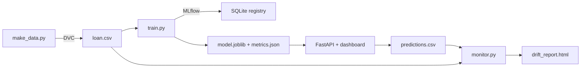

# Loan Default Prediction System

This project demonstrates an end-to-end MLOps workflow for a synthetic loan-default prediction problem. It covers reproducible data generation and DVC versioning, XGBoost training and MLflow tracking, controlled model promotion, FastAPI and dashboard serving, drift monitoring, automated tests, Docker packaging, CI, and Render deployment.



## Tech stack

| Area | Tool |
|---|---|
| Data | Python, pandas, NumPy, DVC |
| Model | XGBoost, scikit-learn |
| Tracking | MLflow, SQLite |
| API | FastAPI, Pydantic, Uvicorn |
| Monitoring | Evidently |
| Testing | pytest |
| Packaging | Docker |
| CI/CD | GitHub Actions |
| Hosting | Render |

## Windows quick start

```powershell
python -m venv .venv
Set-ExecutionPolicy -Scope Process -ExecutionPolicy Bypass
.\.venv\Scripts\Activate.ps1
python -m pip install --upgrade pip
python -m pip install -r requirements.txt

python data\make_data.py
python -m dvc add data\loan.csv
python -m src.train

python -m uvicorn src.api:app --port 8000
python -m pytest -q

python data\make_data.py --drift --seed 9 --out data\loan_new.csv
python -m src.monitor
docker build -t loan-default-api .
```

## Results

| Metric | Value |
|---|---:|
| ROC-AUC | 0.6965 |
| Accuracy | 76.50% |
| Precision | 53.66% |
| Recall | 9.24% |
| F1 | 15.77% |

The production promotion gate accepts only a higher ROC-AUC. The first model was promoted; depth 3 and 5-tree candidates were rejected.

## API endpoints

| Endpoint | Method | Purpose |
|---|---|---|
| `/` | GET | Web dashboard |
| `/predict` | POST | Score a loan application |
| `/metrics` | GET | Current promoted-model metrics |
| `/recent` | GET | Recent prediction log |
| `/health` | GET | Health check |
| `/auth/register` | POST | Create an account and start a session |
| `/auth/login` | POST | Log in and start a session |
| `/auth/logout` | POST | End the current session |
| `/auth/me` | GET | Current user and personal prediction history |
| `/docs` | GET | Swagger API documentation |

## Risk bands

| Probability | Risk level | Decision |
|---|---|---|
| Below 20% | LOW | APPROVE |
| 20% to below 50% | MEDIUM | MANUAL REVIEW |
| 50% or more | HIGH | REJECT |

## Limitations

- The data is synthetic and is not suitable for real credit decisions.
- Recall at threshold 0.5 is low; changing the threshold is a business decision.
- The promotion gate uses one metric only.
- Drift warns of input change but does not prove accuracy changed.
- The SQLite account store is suitable for a demo; it requires persistent storage and production hardening before real use.
- This demo lacks production fairness testing, advanced explainability, multi-factor authentication, and enterprise audit controls.

## Future scope

Add real outcomes, multi-metric promotion gates, probability calibration, fairness checks, explainability, managed database storage, multi-factor authentication, and real-time retraining and deployment automation.
